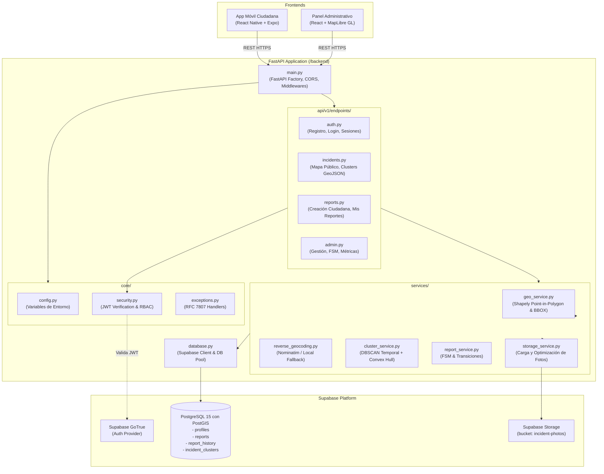
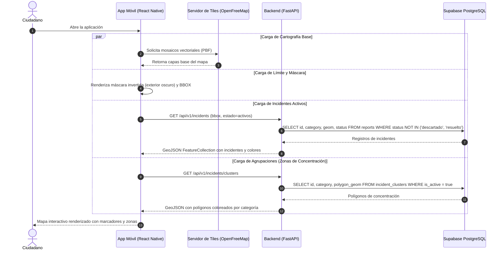
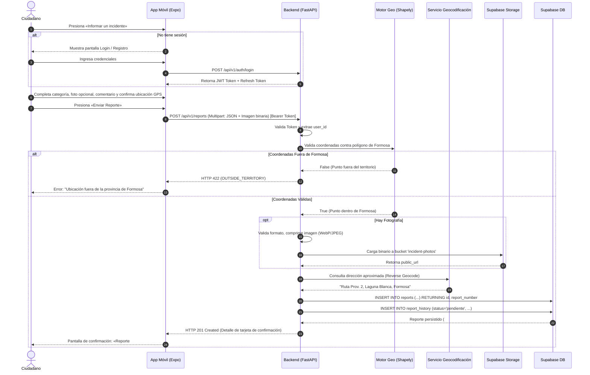
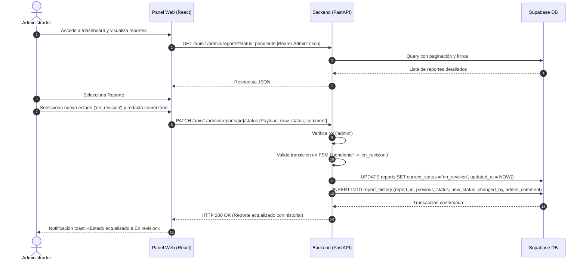

# 01. Arquitectura General del Sistema — NEXO MAP
## NEXO MAP — Sistema de Reporte y Seguimiento de Incidentes Territoriales (Formosa)

---

## 1. Visión General de la Arquitectura

El sistema **NEXO MAP** (Sistema de Reporte y Seguimiento de Incidentes Territoriales) está diseñado bajo una arquitectura cliente-servidor desacoplada basada en servicios REST, con persistencia relacional y geoespacial sobre PostgreSQL (Supabase) y almacenamiento de objetos para evidencias multimedia. Su identidad oficial está representada por el logotipo e isotipo **Nexo_map.png**.

El sistema da respuesta a situaciones de emergencia climática (tales como las provocadas por el fenómeno de El Niño), permitiendo a la ciudadanía registrar incidentes en tiempo real y a los equipos de emergencia provincial monitorear, verificar y gestionar la resolución de los mismos de manera georreferenciada.

```mermaid
flowchart TD
    subgraph Clientes ["Capa de Presentación (Frontend Clients)"]
        MobileApp["App Móvil Ciudadana\n(React Native + Expo SDK 52)"]
        AdminWeb["Panel Web Administrativo\n(React 18 + Vite + Tailwind)"]
    end

    subgraph CDN_Cartografia ["Servicios Cartográficos Externos"]
        TileServer["Servidor de Mosaicos Vectoriales\n(OpenFreeMap / MapLibre Tiles)"]
        Nominatim["Servicio Geocodificación Inversa\n(OSM / Photon Nominatim)"]
    end

    subgraph API_Gateway ["Capa de Servicios y Negocio (Backend)"]
        FastAPI["Backend REST API\n(Python 3.11+ / FastAPI)\n[backend/main.py]"]
        DBConnector["Conector de Datos\n[backend/database.py]"]
        GeoEngine["Motor Geoespacial en Memoria\n(Shapely + formosa.json)"]
    end

    subgraph BaaS ["Capa de Datos y Plataforma (Supabase)"]
        SupaAuth["Supabase Auth\n(GoTrue / JWT Tokens)"]
        PostgresDB[("Supabase PostgreSQL 15+\ncon extensión PostGIS\n(Tablas, Vistas, RLS)")]
        SupaStorage["Supabase Storage\n(Bucket: incident-photos)"]
    end

    MobileApp -->|HTTPS / REST API (JSON)| FastAPI
    AdminWeb -->|HTTPS / REST API (JSON)| FastAPI
    MobileApp -->|Mosaicos Vectoriales PBF| TileServer
    AdminWeb -->|Mosaicos Vectoriales PBF| TileServer
    
    FastAPI -->|Reverse Geocoding HTTP| Nominatim
    FastAPI --> GeoEngine
    FastAPI --> DBConnector
    
    DBConnector -->|SQL / Connection Pool (pgvector/postgis)| PostgresDB
    DBConnector -->|Storage API (Service Role)| SupaStorage
    FastAPI -->|Token Verification / JWKS| SupaAuth
    
    MobileApp -.->|Login / Register Directo| SupaAuth
    AdminWeb -.->|Admin Login Directo| SupaAuth
```

---

## 2. Patrón Arquitectónico y Justificación

### Patrón Seleccionado: Layered Service-Oriented REST Architecture (Arquitectura en Capas Orientada a Servicios REST)

La solución adopta una **arquitectura por capas desacoplada**, guiada por **Spec-Driven Development (SDD)**:

1. **Capa de Presentación:** Dos clientes especializados e independientes que comparten un mismo sistema de diseño visual institucional ([docs/08. visual-design-system.md](08.%20visual-design-system.md)):
   - *Cliente Móvil:* Diseñado para baja latencia, geolocalización en terreno, captura fotográfica y accesibilidad universal. Incorpora el botón flotante central inferior **«Informar»** (fondo blanco `#FFFFFF`, texto e icono en azul `#0475EF`).
   - *Cliente Web:* Diseñado para visualización panorámica, dashboards analíticos, administración masiva y gestión del ciclo de vida de los incidentes.
   - *Identidad Compartida:* Ambos clientes implementan una paleta sobria basada en el azul principal del logo (`#0475EF`), blanco (`#FFFFFF`), fondos `#F7F7F7` y bordes discretos `#E8E5E5`, con tipografía única **Inter** e iconografía vectorial **Lucide Icons** (prohibición estricta de emojis).
2. **Capa de Aplicación y Dominio (FastAPI):** Actúa como la única fuente de verdad funcional. Centraliza las reglas de negocio, la validación geométrica territorial, las transiciones de estados, la auditoría y los algoritmos de concentración geográfica.
3. **Capa de Persistencia y Almacenamiento (Supabase PostgreSQL + Storage):** Almacenamiento transaccional ACID, indexación espacial PostGIS y almacenamiento de objetos seguro.

### Justificación Técnica
- **Aislamiento de la Lógica Territorial:** El límite territorial de Formosa (`formosa.json`, 11.673 vértices) no debe delegarse al cliente móvil ni al navegador web por razones de seguridad, consumo de batería y riesgo de manipulación de payloads. Centralizarlo en FastAPI garantiza que ningún reporte fuera del territorio pueda persistirse.
- **Contratos Universales (SDD):** Al fijar un contrato HTTP/JSON formal (`docs/system-contracts.md`), los equipos o agentes que desarrollen la aplicación móvil y el panel web pueden avanzar en paralelo sin dependencias bloqueantes ni ambigüedades.
- **Independencia Tecnológica:** Supabase actúa como motor de base de datos y autenticación, pero el backend no expone directamente las tablas a los clientes, evitando el acoplamiento directo y permitiendo implementar rate limiting, validaciones personalizadas y preprocesamiento de imágenes.

---

## 3. Componentes Principales y Matriz de Responsabilidades

| Componente | Tecnologías | Responsabilidad Principal | Responsabilidades Excluidas |
| :--- | :--- | :--- | :--- |
| **App Móvil Ciudadana** | React Native, Expo (Dev Client), TypeScript, MapLibre React Native | - Consulta pública de incidentes en mapa.<br>- Formulario asistido con GPS.<br>- Captura y selección de fotos.<br>- Seguimiento de "Mis reportes" con timeline.<br>- Configuración de accesibilidad y temas. | - No valida polígonos complejos.<br>- No realiza agrupamiento espacial pesado.<br>- No accede directamente a la base de datos sin token de usuario. |
| **Panel Web Administrativo** | React 18, Vite, TypeScript, Tailwind CSS, `react-map-gl/maplibre` | - Autenticación de operadores.<br>- Dashboard de estadísticas en vivo.<br>- Tabla interactiva con filtros multidimensionales.<br>- Mapa operativo con polígonos de concentración.<br>- Actualización de estados y comentarios públicos. | - No expone endpoints.<br>- No almacena claves maestras (`service_role`). |
| **Backend API Gateway** | Python 3.11+, FastAPI, Pydantic v2, Shapely, Uvicorn | - Verificación criptográfica de tokens JWT.<br>- Validación estricta de coordenadas dentro de Formosa.<br>- Control de la máquina de estados de reportes.<br>- Geocodificación inversa automática.<br>- Generación de zonas de concentración (clusters).<br>- Auditoría cronológica de cambios. | - No almacena estado en sesión (Stateless).<br>- No compila vistas ni sirve contenido HTML estático. |
| **Base de Datos y Persistencia** | Supabase (PostgreSQL 15+, PostGIS) | - Almacenamiento ACID de usuarios, reportes, historial y clusters.<br>- Consultas espaciales indexadas (`GiST`).<br>- Garantía de identificadores secuenciales únicos. | - No ejecuta lógica de negocio no estándar.<br>- No valida formatos fotográficos binarios. |
| **Almacenamiento de Archivos** | Supabase Storage (S3 compatible) | - Alojamiento seguro y distribución CDN de imágenes.<br>- Políticas de lectura pública optimizada. | - No procesa transformaciones complejas de imagen. |

---

## 4. Diagrama General de Arquitectura (Mermaid)

El siguiente diagrama detalla la interacción interna entre módulos, servicios y almacenes de datos:



---

## 5. Flujos de Comunicación del Sistema

### 5.1. Flujo 1: Exploración Pública del Mapa (Sin inicio de sesión)
Cualquier ciudadano puede abrir la app móvil o un visitante el panel público para consultar incidentes activos:



### 5.2. Flujo 2: Creación de Reporte Ciudadano (Con autenticación y foto)



### 5.3. Flujo 3: Gestión Administrativa y Actualización de Estado con Comentario



---

## 6. Manejo de Autenticación y Autorización (RBAC)

El sistema implementa **Role-Based Access Control (RBAC)** con dos roles bien diferenciados:

1. **`citizen` (Ciudadano):**
   - Puede consultar el mapa público sin credenciales.
   - Requiere autenticación para enviar reportes (`POST /api/v1/reports`).
   - Solo puede consultar el detalle de sus propios reportes (`GET /api/v1/reports/me`).
2. **`admin` (Operador / Autoridad Provincial):**
   - Requiere inicio de sesión obligatorio en el panel web.
   - Acceso irrestricto a todos los reportes, fotos, contactos de ciudadanos y coordenadas exactas.
   - Autorizado para ejecutar transiciones de estado, ingresar comentarios administrativos y visualizar el panel de métricas consolidado.

### Verificación de Tokens en FastAPI
FastAPI no almacena sesiones en disco ni memoria (arquitectura Stateless). La autorización se gestiona mediante inyección de dependencias (`Depends`):

- El cliente envía la cabecera: `Authorization: Bearer <jwt_token>`.
- El módulo `core/security.py` decodifica la firma del token utilizando la clave secreta o claves públicas (JWKS) provistas por Supabase Auth.
- Se extrae el `sub` (UUID del usuario) y se consulta su rol en la tabla `profiles`.
- Se proporcionan dos dependencias principales:
  - `get_current_user`: Valida que el token esté vigente y pertenezca a un usuario registrado.
  - `require_admin`: Comprueba además que `user.role == 'admin'`. De lo contrario, emite un error `HTTP 403 Forbidden`.

---

## 7. Gestión Estandarizada de Errores

Para garantizar consistencia entre clientes y backend, todas las respuestas de error siguen una variante simplificada del estándar **RFC 7807 (Problem Details for HTTP APIs)**:

```json
{
  "error": {
    "code": "OUTSIDE_TERRITORY",
    "message": "La ubicación seleccionada se encuentra fuera del territorio provincial de Formosa.",
    "details": {
      "latitude": -25.2987,
      "longitude": -56.8921,
      "allowed_bounds": {
        "min_lon": -62.34245,
        "min_lat": -26.87201,
        "max_lon": -57.55426,
        "max_lat": -22.47651
      }
    },
    "timestamp": "2026-11-18T18:30:00Z"
  }
}
```

### Tabla de Códigos de Error Principales
| Código HTTP | `error.code` | Causa |
| :--- | :--- | :--- |
| `400 Bad Request` | `INVALID_INPUT` | Parámetros inválidos o sintaxis JSON incorrecta. |
| `401 Unauthorized` | `AUTH_REQUIRED` / `TOKEN_EXPIRED` | Falta token o ha expirado. |
| `403 Forbidden` | `FORBIDDEN_RESOURCE` | Un ciudadano intenta acceder a rutas de administración. |
| `404 Not Found` | `REPORT_NOT_FOUND` | El ID del reporte no existe en la base de datos. |
| `409 Conflict` | `INVALID_STATE_TRANSITION` | Intento de transición no permitida en la máquina de estados. |
| `422 Unprocessable Entity` | `OUTSIDE_TERRITORY` | Coordenadas fuera del polígono provincial de Formosa. |
| `422 Unprocessable Entity` | `VALIDATION_ERROR` | Falla regla condicional (ej. falta comentario y falta foto). |
| `429 Too Many Requests` | `RATE_LIMIT_EXCEEDED` | Se superó el límite de solicitudes por minuto. |
| `500 Internal Server Error` | `INTERNAL_SERVER_ERROR` | Error no controlado en el servidor. |

---

## 8. Seguridad Integral del Sistema

1. **Principio de Menor Privilegio en Credenciales:**
   - La clave `supabase_service_role_key` tiene permisos totales de administración y **nunca** se incluye en las aplicaciones cliente. Reside exclusivamente como variable de entorno del backend FastAPI.
   - Las aplicaciones clientes solo reciben la `anon_key` de Supabase para operaciones de autenticación directa con el servicio Auth (GoTrue).
2. **Protección de Datos Personales del Ciudadano:**
   - Los endpoints públicos (`/api/v1/incidents`) devuelven únicamente información pública del incidente: ID, categoría, coordenadas aproximadas, fecha, estado actual y URL de foto.
   - La identidad del ciudadano denunciante (nombre, correo, teléfono y coordenadas submétricas) **nunca** se expone en la API pública; queda reservada para los endpoints administrativos protegidos (`/api/v1/admin/reports`).
3. **Mitigación de Saturación por Emergencias (Rate Limiting):**
   - El backend implementa limitadores de tasa con `SlowAPI` basados en la IP del cliente y el ID de usuario (ej. máximo 5 reportes por minuto por usuario autenticado), evitando ataques de denegación de servicio o spam durante contingencias climáticas.
4. **Validación y Sanitización de Archivos Binarios:**
   - Se validan los bytes de cabecera (Magic Numbers) de cada archivo subido para garantizar que sean exclusivamente imágenes (`image/jpeg`, `image/png`, `image/webp`).
   - Se establece un límite estricto de tamaño de archivo (5 MB por fotografía).
   - Se redimensionan las imágenes en el servidor a un máximo de 1920x1080 px para mitigar vulnerabilidades tipo *Image Bomb*.

---

## 9. Consideraciones de Rendimiento y Escalabilidad

1. **Indexación Espacial GiST en PostgreSQL:**
   - Todas las consultas geográficas aprovechan índices espaciales `CREATE INDEX idx_reports_geom ON reports USING GIST (geom);`. Esto permite responder consultas de caja envolvente (`BBOX`) en milisegundos incluso con cientos de miles de registros.
2. **Caché en Memoria del Polígono Territorial:**
   - El archivo `Fsa_geojson/formosa.json` (11.673 vértices) se procesa una única vez al levantar FastAPI en `backend/main.py` utilizando la estructura `shapely.prepared.prep`. Cada validación de punto dentro de polígono insume menos de 0.05 ms de CPU.
3. **Cálculo Asíncrono de Zonas de Concentración (Clusters):**
   - Las zonas de concentración no se calculan al vuelo en cada petición de mapa. Se recalculan mediante un servicio en segundo plano cuando un reporte cambia a `verificado` o `en_seguimiento`, y se guardan en la tabla `incident_clusters`. La API pública lee de esta tabla de manera directa.
4. **Caché de Mosaicos Vectoriales:**
   - Los clientes consumen mosaicos vectoriales alojados en servidores CDN globales (OpenFreeMap), reduciendo a cero la carga cartográfica en la infraestructura propia.

---

## 10. Limitaciones Conocidas y Estrategias de Mitigación

| Limitación | Causa | Mitigación Arquitectónica |
| :--- | :--- | :--- |
| **Incompatibilidad de MapLibre con Expo Go Estándar** | `@maplibre/maplibre-react-native` requiere binarios C++ y librerías nativas que no existen en el cliente estándar de las tiendas. | Adopción de **Expo Development Builds** (`expo-dev-client`). Permite previsualización en vivo en dispositivos físicos con live-reload idéntico a Expo Go una vez compilado el APK de desarrollo. *(Ver ADR-004)* |
| **Imprecisión de GPS en Interiores o Clima Adverso** | Rebote de señal satelital durante tormentas intensas. | La app móvil incluye un flujo interactivo de corrección: botón «¿La ubicación no es correcta? ¡Corregir!», permitiendo al ciudadano arrastrar un pin o pulsar sobre el mapa para ajustar la coordenada manualmente. |
| **Conectividad Inestable en Zonas Rurales de Formosa** | Caída de antenas celulares durante emergencias hídricas. | La aplicación móvil implementa un almacenamiento temporal local con AsyncStorage / SQLite para que el usuario no pierda el borrador de su reporte si la conexión falla durante el envío. |
| **Límite de Geodecodificación Gratuita (Nominatim)** | Política de uso de 1 req/seg en el servicio público de OpenStreetMap. | FastAPI implementa una caché interna de direcciones por cuadrícula espacial de 100 metros. Si la consulta externa falla o se satura, el backend asigna una referencia sintética como `"Coordenadas: [lat, lon], Formosa"` sin bloquear la creación del reporte (`03` §4.2 usa `"Ubicación Formosa (lat, lon)"`; los clientes reconocen ambos formatos). La app móvil muestra una referencia preliminar propia (`05` §4.2.b), pero solo envía coordenadas. |
