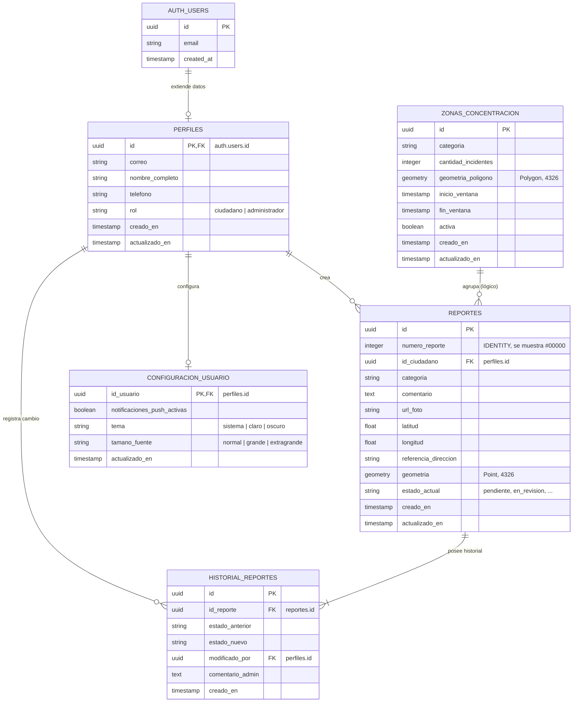

# 06. Base de Datos y Almacenamiento — NEXO MAP (Supabase PostgreSQL & Storage)
## NEXO MAP — Sistema de Reporte y Seguimiento de Incidentes Territoriales (Formosa)

Este documento define el modelo relacional, tipos de datos geoespaciales, políticas de seguridad por fila (RLS), índices de rendimiento y arquitectura de almacenamiento de objetos en Supabase para el ecosistema **NEXO MAP**.

> **Esquema implementado en español (2026-11-20).** La base del proyecto Supabase (`irmoexjtcssoopxdfpcd`) se creó con nombres de tablas, columnas y valores en español. Este documento describe ese esquema real. La API (`02. system-contracts.md`) **no cambia**: sigue en inglés (`role: citizen | admin`, `report_number`, `current_status`…), y el backend traduce en sus consultas SQL con alias (sección 7). La versión original en inglés de este documento se conserva en `supabase/migrations/20261118000001_initial_schema.sql` como referencia histórica y **no debe ejecutarse** sobre el proyecto.

---

## 1. Justificación y Adopción de PostGIS

### Decisión Técnica: PostGIS Habilitado
Se evalúa e incorpora la extensión **PostGIS 3+** sobre la instancia PostgreSQL de Supabase (instalada: PostGIS 3.3 sobre PostgreSQL 17).

#### Justificación:
1. **Indexación Espacial Nativa (`GiST`):** Las consultas de incidentes en mapas se ejecutan filtrando por la caja envolvente visible del usuario (`BBOX`). Un índice `GiST` sobre una columna `GEOMETRY(Point, 4326)` permite resolver búsquedas geográficas en menos de 1 milisegundo mediante el operador `&&` (`ST_MakeEnvelope`), evitando escaneos secuenciales de tabla completa.
2. **Consultas de Distancia y Clustering:** El cálculo de zonas de concentración exige medir la distancia geodésica entre incidentes (radio $\le 800$ metros). PostGIS permite utilizar `ST_DWithin(geom::geography, other_geom::geography, 800)` y funciones de agrupamiento como `ST_ConvexHull` y `ST_Buffer` de forma atómica en el motor de base de datos.
3. **Compatibilidad Estándar OGC y GeoJSON:** PostGIS permite serializar geometrías directamente a GeoJSON con `ST_AsGeoJSON(geom)`, agilizando la respuesta del backend hacia MapLibre.

---

## 2. Diagrama Entidad-Relación (Mermaid ERD)



---

## 3. Definición DDL de Tablas y Esquema Relacional

Las tablas se crearon con el *Table Editor* de Supabase. El DDL siguiente es su definición verificada (`supabase/checks/verify_schema.sql`). Las piezas de seguridad y storage se aplican con `supabase/migrations/20261120000003_esquema_es.sql` y `20261120000004_permisos_service_role.sql`.

### 3.1. Habilitación de Extensiones
```sql
CREATE EXTENSION IF NOT EXISTS "uuid-ossp";
CREATE EXTENSION IF NOT EXISTS "postgis";   -- instalada en el esquema public (crea spatial_ref_sys)
CREATE EXTENSION IF NOT EXISTS "pgcrypto";  -- gen_random_uuid()
```

### 3.2. Tabla `perfiles` (Perfiles de Usuario)
Extiende el esquema `auth.users` provisto por Supabase:

```sql
CREATE TABLE public.perfiles (
    id UUID PRIMARY KEY REFERENCES auth.users(id) ON DELETE CASCADE,
    correo TEXT NOT NULL,
    nombre_completo TEXT NOT NULL,
    telefono TEXT,
    rol TEXT NOT NULL DEFAULT 'ciudadano' CHECK (rol IN ('ciudadano', 'administrador')),
    creado_en TIMESTAMPTZ NOT NULL DEFAULT timezone('utc', now()),
    actualizado_en TIMESTAMPTZ NOT NULL DEFAULT timezone('utc', now())
);

-- Trigger de alta: crea el perfil y la configuración de cada usuario nuevo de auth.users.
-- Seguridad: el rol es SIEMPRE 'ciudadano'. No se lee de raw_user_meta_data, porque el cliente controla
-- esos metadatos y podría registrarse como administrador con la clave pública.
CREATE OR REPLACE FUNCTION public.manejar_nuevo_usuario()
RETURNS trigger
LANGUAGE plpgsql
SECURITY DEFINER
SET search_path = ''
AS $function$
BEGIN
    INSERT INTO public.perfiles (id, correo, nombre_completo, telefono, rol)
    VALUES (
        new.id,
        new.email,
        COALESCE(new.raw_user_meta_data->>'nombre_completo', new.raw_user_meta_data->>'full_name', 'Ciudadano'),
        COALESCE(new.raw_user_meta_data->>'telefono', new.raw_user_meta_data->>'phone_number'),
        'ciudadano'
    );

    INSERT INTO public.configuracion_usuario (id_usuario)
    VALUES (new.id);

    RETURN new;
END;
$function$;

CREATE TRIGGER al_crear_usuario_autenticado
    AFTER INSERT ON auth.users
    FOR EACH ROW EXECUTE FUNCTION public.manejar_nuevo_usuario();
```

**Alta de operadores:** los administradores se promueven solo por SQL, nunca desde un cliente:
```sql
UPDATE public.perfiles SET rol = 'administrador', actualizado_en = timezone('utc', now())
WHERE correo = 'operador@ejemplo.gob.ar';
```

---

### 3.3. Tabla `reportes` (Reportes de Incidentes)
Centraliza la información de los avisos registrados:

```sql
CREATE TABLE public.reportes (
    id UUID PRIMARY KEY DEFAULT gen_random_uuid(),
    numero_reporte INT GENERATED ALWAYS AS IDENTITY,
    id_ciudadano UUID NOT NULL REFERENCES public.perfiles(id) ON DELETE RESTRICT,
    categoria TEXT NOT NULL CHECK (categoria IN (
        'calle_anegada',
        'camino_interrumpido',
        'desborde_rio_riacho',
        'vivienda_estructura_daniada',
        'arbol_caido',
        'obstruccion_desague',
        'poste_cable_caido',
        'danos_infraestructura_publica',
        'corte_servicios_basicos',
        'otro'
    )),
    comentario TEXT,
    url_foto TEXT,
    latitud DOUBLE PRECISION NOT NULL,
    longitud DOUBLE PRECISION NOT NULL,
    referencia_direccion TEXT NOT NULL,
    geometria GEOMETRY(Point, 4326) NOT NULL,
    estado_actual TEXT NOT NULL DEFAULT 'pendiente' CHECK (estado_actual IN (
        'pendiente',
        'en_revision',
        'verificado',
        'descartado',
        'en_seguimiento',
        'resuelto'
    )),
    creado_en TIMESTAMPTZ NOT NULL DEFAULT timezone('utc', now()),
    actualizado_en TIMESTAMPTZ NOT NULL DEFAULT timezone('utc', now()),

    -- Restricción de integridad: debe haber foto o comentario
    CONSTRAINT chk_foto_o_comentario CHECK (
        (url_foto IS NOT NULL AND length(url_foto) > 0) OR
        (comentario IS NOT NULL AND length(trim(comentario)) > 0)
    )
);

-- Índices de Rendimiento
CREATE INDEX idx_reportes_geometria ON public.reportes USING GIST (geometria);
CREATE INDEX idx_reportes_id_ciudadano ON public.reportes (id_ciudadano);
CREATE INDEX idx_reportes_estado_actual ON public.reportes (estado_actual);
CREATE INDEX idx_reportes_categoria ON public.reportes (categoria);
CREATE INDEX idx_reportes_creado_en ON public.reportes (creado_en DESC);
```

Los valores de `categoria` y `estado_actual` son las claves del contrato (`02` §2.1 y §2.2), sin traducción.

---

### 3.4. Tabla `historial_reportes` (Trazabilidad y Comentarios Administrativos)
Garantiza que ningún cambio de estado o comentario sea anónimo o efímero:

```sql
CREATE TABLE public.historial_reportes (
    id UUID PRIMARY KEY DEFAULT gen_random_uuid(),
    id_reporte UUID NOT NULL REFERENCES public.reportes(id) ON DELETE CASCADE,
    estado_anterior TEXT CHECK (estado_anterior IN ('pendiente', 'en_revision', 'verificado', 'descartado', 'en_seguimiento', 'resuelto')),
    estado_nuevo TEXT NOT NULL CHECK (estado_nuevo IN ('pendiente', 'en_revision', 'verificado', 'descartado', 'en_seguimiento', 'resuelto')),
    modificado_por UUID NOT NULL REFERENCES public.perfiles(id) ON DELETE RESTRICT,
    comentario_admin TEXT,
    creado_en TIMESTAMPTZ NOT NULL DEFAULT timezone('utc', now())
);

CREATE INDEX idx_historial_reportes_id_reporte ON public.historial_reportes (id_reporte, creado_en ASC);
```

**Retención:** los reportes no se eliminan desde la aplicación. `resuelto` y `descartado` son estados finales que salen del mapa público (§4.1) pero se conservan, junto con su historial inmutable, para la auditoría y para «Mis reportes» del ciudadano. El `ON DELETE CASCADE` solo actúa en un borrado administrativo por SQL.

---

### 3.5. Tabla `zonas_concentracion` (Zonas de Concentración)
Almacena los polígonos generados por el algoritmo de clustering para su consumo ultra-rápido:

```sql
CREATE TABLE public.zonas_concentracion (
    id UUID PRIMARY KEY DEFAULT gen_random_uuid(),
    categoria TEXT NOT NULL,
    cantidad_incidentes INT NOT NULL DEFAULT 3,
    geometria_poligono GEOMETRY(Polygon, 4326) NOT NULL,
    inicio_ventana TIMESTAMPTZ NOT NULL,
    fin_ventana TIMESTAMPTZ NOT NULL,
    activa BOOLEAN NOT NULL DEFAULT true,
    creado_en TIMESTAMPTZ NOT NULL DEFAULT timezone('utc', now()),
    actualizado_en TIMESTAMPTZ NOT NULL DEFAULT timezone('utc', now())
);

CREATE INDEX idx_zonas_concentracion_geometria ON public.zonas_concentracion USING GIST (geometria_poligono);
CREATE INDEX idx_zonas_concentracion_activa ON public.zonas_concentracion (activa) WHERE activa = true;
```

---

### 3.6. Tabla `configuracion_usuario` (Preferencias de Usuario)
```sql
CREATE TABLE public.configuracion_usuario (
    id_usuario UUID PRIMARY KEY REFERENCES public.perfiles(id) ON DELETE CASCADE,
    notificaciones_push_activas BOOLEAN NOT NULL DEFAULT false, -- Inicia desactivado según contexto
    tema TEXT NOT NULL DEFAULT 'sistema' CHECK (tema IN ('sistema', 'claro', 'oscuro')),
    tamano_fuente TEXT NOT NULL DEFAULT 'normal' CHECK (tamano_fuente IN ('normal', 'grande', 'extragrande')),
    actualizado_en TIMESTAMPTZ NOT NULL DEFAULT timezone('utc', now()),
    token_push TEXT  -- DEP-00: identificador Expo/Firebase de la app instalada (ExponentPushToken[...])
);

-- Un token pertenece a un solo usuario (migración 20261120000005_notificaciones_push.sql)
CREATE UNIQUE INDEX idx_configuracion_usuario_token_push
    ON public.configuracion_usuario (token_push) WHERE token_push IS NOT NULL;
```
`notificaciones_push_activas` y `token_push` los escribe el backend con `PUT /users/me/notifications` (`02` §5); el envío se describe en `03` §4.6.
La app móvil guarda tema y tamaño de letra en el dispositivo; la preferencia de notificaciones y el token se escriben con `PUT /users/me/notifications` (`02` §5). La fila se crea con el trigger de alta.

---

## 4. Consultas de Alto Rendimiento

### 4.1. Consulta de Incidentes Activos en BBOX (Carga del Mapa)
```sql
SELECT
    id,
    '#' || LPAD(numero_reporte::text, 5, '0') AS report_number,
    categoria AS category,
    estado_actual AS current_status,
    referencia_direccion AS address_reference,
    url_foto AS photo_url,
    creado_en AS created_at,
    ST_AsGeoJSON(geometria)::json AS geometry
FROM public.reportes
WHERE estado_actual NOT IN ('descartado', 'resuelto')
  AND geometria && ST_MakeEnvelope(:min_lon, :min_lat, :max_lon, :max_lat, 4326);
```

### 4.2. Detección de Incidentes Cercanos de la Misma Categoría ($\le 10$ días)
```sql
SELECT r2.id, r2.geometria, r2.creado_en
FROM public.reportes r1
JOIN public.reportes r2
  ON r1.categoria = r2.categoria
 AND r1.id != r2.id
WHERE r1.id = :target_report_id
  AND r2.estado_actual IN ('verificado', 'en_seguimiento')
  AND r2.creado_en >= (NOW() - INTERVAL '10 days')
  AND ST_DWithin(r1.geometria::geography, r2.geometria::geography, 800); -- Distancia <= 800 metros
```

### 4.3. Búsqueda Administrativa (`GET /admin/reports?search=`)
El texto se busca en el comentario, en la referencia de dirección y en el número formateado, de modo que `#00142`, `00142` y `142` encuentran el reporte (`02` §6):
```sql
WHERE (r.comentario ILIKE :q OR r.referencia_direccion ILIKE :q
       OR ('#' || lpad(r.numero_reporte::text, 5, '0')) ILIKE :q)
```

---

## 5. Supabase Storage: Gestión de Fotografías

### 5.1. Organización del Bucket
- **Nombre del Bucket:** `incident-photos`
- **Visibilidad Pública:** `true` (los objetos se sirven directamente vía CDN público para alta velocidad de renderizado en el mapa y en las aplicaciones).
- **Límite de Tamaño de Archivo:** 5 MB (`5242880` bytes).
- **Tipos MIME Permitidos:** `image/jpeg`, `image/png`, `image/webp`.
- **Escritura:** solo el backend con la clave secreta (`service_role`). No hay políticas de INSERT, UPDATE ni DELETE para `anon` o `authenticated`.
- **Creación:** `supabase/migrations/20261120000003_esquema_es.sql`, sección 1.

### 5.2. Convención de Nomenclatura y Rutas
Para evitar colisiones y organizar lógicamente las evidencias:
```text
incident-photos/
└── reports/
    └── {YYYY}/
        └── {MM}/
            └── {report_id}_{timestamp_hash}.webp
```
*Ejemplo:* `reports/2026/11/9f8e7d6c-5b4a-3f2e-1d0c-ba9876543210_a1b2c3d4.webp`

URL pública resultante: `https://<proyecto>.supabase.co/storage/v1/object/public/incident-photos/reports/…`.

---

## 6. Políticas de Seguridad (Row Level Security - RLS)

Aunque el backend FastAPI canaliza las operaciones con la clave `service_role` (que elude el RLS para aplicar reglas de negocio complejas) y con la conexión directa de PostgreSQL, se implementan políticas estrictas de RLS para blindar la base de datos ante cualquier intento de acceso directo desde clientes.

La comprobación de administrador se hace con una función `SECURITY DEFINER`. Si una política de `perfiles` consultara `perfiles` directamente, PostgreSQL rechazaría la consulta con «infinite recursion detected in policy».

```sql
-- RLS activo en todas las tablas
ALTER TABLE public.perfiles ENABLE ROW LEVEL SECURITY;
ALTER TABLE public.reportes ENABLE ROW LEVEL SECURITY;
ALTER TABLE public.historial_reportes ENABLE ROW LEVEL SECURITY;
ALTER TABLE public.zonas_concentracion ENABLE ROW LEVEL SECURITY;
ALTER TABLE public.configuracion_usuario ENABLE ROW LEVEL SECURITY;

-- Función auxiliar sin recursión
CREATE OR REPLACE FUNCTION public.es_administrador()
RETURNS boolean
LANGUAGE sql STABLE SECURITY DEFINER SET search_path = ''
AS $function$
    SELECT EXISTS (SELECT 1 FROM public.perfiles WHERE id = auth.uid() AND rol = 'administrador');
$function$;

-- 1. perfiles
CREATE POLICY "Lectura de perfil propio o por administrador"
    ON public.perfiles FOR SELECT
    USING (auth.uid() = id OR public.es_administrador());

CREATE POLICY "Modificación de perfil propio"
    ON public.perfiles FOR UPDATE
    USING (auth.uid() = id);

-- 2. reportes
CREATE POLICY "Lectura pública de reportes activos no descartados"
    ON public.reportes FOR SELECT
    USING (estado_actual NOT IN ('descartado'));

CREATE POLICY "Ciudadanos autenticados pueden insertar sus propios reportes"
    ON public.reportes FOR INSERT
    WITH CHECK (auth.uid() = id_ciudadano);

CREATE POLICY "Solo administradores pueden modificar reportes"
    ON public.reportes FOR UPDATE
    USING (public.es_administrador());

-- 3. historial_reportes
CREATE POLICY "Lectura de historial de reportes propios o por administradores"
    ON public.historial_reportes FOR SELECT
    USING (
        public.es_administrador()
        OR EXISTS (SELECT 1 FROM public.reportes r WHERE r.id = id_reporte AND r.id_ciudadano = auth.uid())
    );

-- 4. zonas_concentracion
CREATE POLICY "Lectura pública de zonas de concentración activas"
    ON public.zonas_concentracion FOR SELECT
    USING (activa = true);

-- 5. configuracion_usuario ("Lectura de configuración propia" y "Modificación de configuración propia")
--    Acceso solo a la fila propia: auth.uid() = id_usuario.

-- 6. Storage: lectura pública del bucket
CREATE POLICY "Lectura pública de fotografías de incidentes"
    ON storage.objects FOR SELECT
    USING (bucket_id = 'incident-photos');
```

**Permisos de `service_role`:** las tablas creadas con el *Table Editor* no otorgaban privilegios a `service_role` (la API REST respondía `42501 permission denied`). `20261120000004_permisos_service_role.sql` le concede `ALL` sobre las 5 tablas. `anon` y `authenticated` no reciben permisos nuevos: los clientes acceden solo a través del backend.

---

## 7. Correspondencia con el Contrato de la API (`02`)

El backend (`backend/services/report_service.py` y `cluster_service.py`) consulta las tablas en español y devuelve las claves en inglés del contrato mediante alias SQL:

| Base de datos (español) | API / contrato `02` (inglés) |
| :--- | :--- |
| `perfiles` (`correo`, `nombre_completo`, `telefono`, `rol`) | `user` / `citizen` / `operator` (`email`, `full_name`, `phone_number`, `role`) |
| `rol = 'ciudadano'` / `'administrador'` | `role = "citizen"` / `"admin"` (`CASE p.rol WHEN 'administrador' THEN 'admin' ELSE 'citizen' END`) |
| `reportes.numero_reporte` (entero) | `report_number` (`"#00042"`) |
| `reportes.id_ciudadano`, `categoria`, `comentario`, `url_foto` | `citizen_id`, `category`, `comment` / `citizen_comment`, `photo_url` |
| `reportes.latitud`, `longitud`, `referencia_direccion`, `geometria` | `location.latitude`, `location.longitude`, `location.address_reference`, `geometry` |
| `reportes.estado_actual`, `creado_en`, `actualizado_en` | `current_status` / `status`, `created_at`, `updated_at` |
| `historial_reportes` (`estado_anterior`, `estado_nuevo`, `modificado_por`, `comentario_admin`) | `history` / `timeline` (`previous_status`, `new_status`, `changed_by`, `admin_comment`) |
| `zonas_concentracion` (`cantidad_incidentes`, `geometria_poligono`, `inicio_ventana`, `fin_ventana`, `activa`) | clusters (`incident_count`, `geometry`, `window_start`, `window_end`; solo activas) |

## 8. Migraciones (`supabase/migrations/`)

| Archivo | Estado en el proyecto | Contenido |
| :--- | :--- | :--- |
| `20261118000001_initial_schema.sql` | **No ejecutar** (histórico) | Esquema original en inglés de este documento. |
| `20261118000002_storage_setup.sql` | **No ejecutar** (incluido en 0003) | Bucket `incident-photos`. |
| `20261120000003_esquema_es.sql` | Aplicada (2026-11-20) | Bucket y política de lectura; trigger con rol fijo `ciudadano`; `es_administrador()` y políticas sin recursión. Idempotente. |
| `20261120000004_permisos_service_role.sql` | Aplicada (2026-11-20) | `GRANT ALL` a `service_role` sobre las 5 tablas. Idempotente. |
| `20261120000005_notificaciones_push.sql` | Aplicada (2026-11-20) | Columna `token_push` e índice único parcial (DEP-00). Idempotente. |

Verificación de solo lectura del estado de la base: `supabase/checks/verify_schema.sql`.
