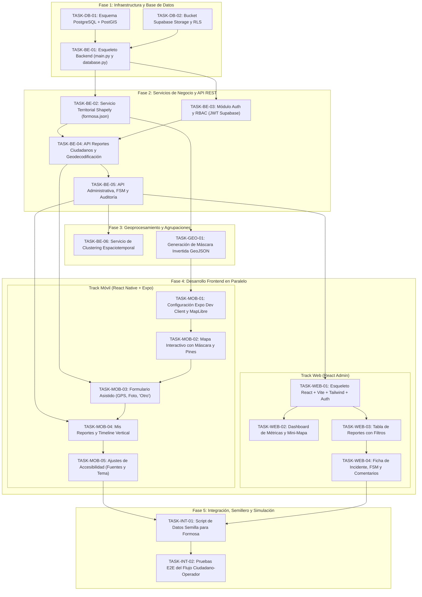

# 07. Plan de Implementación Ordenado por Fases — NEXO MAP (Spec-Driven Development)
## NEXO MAP — Sistema de Reporte y Seguimiento de Incidentes Territoriales (Formosa)

Este plan desglosa la construcción del MVP para la hackathon en tareas atómicas y altamente específicas para el ecosistema **NEXO MAP**. Cada tarea define sus dependencias, contratos a respetar, criterios de aceptación y métodos de verificación para permitir que distintos agentes de desarrollo o desarrolladores humanos trabajen de manera simultánea sin fricciones.

---

## 1. Diagrama de Fases y Dependencias Generales

---

## 2. Especificación Detallada de Tareas

---

### Fase 1: Infraestructura y Base de Datos

#### `TASK-DB-01`: Despliegue del Esquema PostgreSQL con Extensión PostGIS
- **Objetivo:** Crear las tablas relacionales, disparadores de perfiles, tipos enumerados e índices espaciales en Supabase.
- **Archivos Involucrados:** `supabase/migrations/20261118000001_initial_schema.sql`.
- **Dependencias:** Proyecto Supabase activo.
- **Contratos a Respetar:** `docs/06. database-storage.md` (Sección 3).
- **Criterios de Aceptación:**
  1. Extensión `postgis` habilitada correctamente.
  2. Tablas `profiles`, `reports`, `report_history`, `incident_clusters` y `user_settings` creadas con claves primarias y foráneas.
  3. Columna `geom` de tipo `GEOMETRY(Point, 4326)` con índice espacial `GiST`.
  4. Secuencia `report_number` autoincremental operativa.
  5. Trigger `handle_new_user` crea automáticamente el registro en `profiles` tras un registro en `auth.users`.
- **Verificación:** Ejecutar inserción de prueba en `auth.users` y comprobar la propagación en `profiles`. Comprobar con `SELECT PostGIS_Version();`.

---

#### `TASK-DB-02`: Configuración del Bucket de Fotografías y Políticas de Acceso
- **Objetivo:** Inicializar el bucket de Supabase Storage para alojar las evidencias fotográficas de los reportes.
- **Archivos Involucrados:** `supabase/migrations/20261118000002_storage_setup.sql`.
- **Dependencias:** `TASK-DB-01`.
- **Contratos a Respetar:** `docs/06. database-storage.md` (Sección 5).
- **Criterios de Aceptación:**
  1. Bucket `incident-photos` creado con acceso público habilitado para lectura.
  2. Límite de 5 MB por archivo y tipos MIME restringidos a JPEG, PNG y WebP.
  3. Políticas RLS de Storage que impiden escritura anónima directa.
- **Verificación:** Intentar descargar una imagen pública vía URL HTTP directa y verificar que se devuelva con código 200.

---

#### `TASK-BE-01`: Inicialización del Esqueleto del Backend y Conector Supabase
- **Objetivo:** Configurar la aplicación FastAPI respetando obligatoriamente los archivos base `backend/main.py` y `backend/database.py`.
- **Archivos Involucrados:**
  - `backend/main.py`
  - `backend/database.py`
  - `backend/core/config.py`
  - `backend/requirements.txt`
  - `backend/.env.example`
- **Dependencias:** `TASK-DB-01`.
- **Contratos a Respetar:** `docs/03. backend.md` (Secciones 1 y 2).
- **Criterios de Aceptación:**
  1. `main.py` inicializa `FastAPI`, configura CORS para orígenes permitidos y monta el enrutador `/api/v1`.
  2. `database.py` expone el cliente singleton de `supabase-py` y la conexión directa a PostgreSQL.
  3. Endpoint `GET /health` devuelve `{"status": "ok"}` con código HTTP 200.
- **Verificación:** Ejecutar `uvicorn main:app --reload` y consultar `curl -i http://localhost:8000/health`.

---

### Fase 2: Servicios de Negocio y API REST

#### `TASK-BE-02`: Motor de Validación Territorial con `formosa.json` (Shapely)
- **Objetivo:** Implementar la validación geométrica en memoria que asegura que ninguna coordenada fuera de la provincia de Formosa sea aceptada.
- **Archivos Involucrados:**
  - `backend/services/geo_service.py`
  - `backend/core/exceptions.py`
  - `backend/tests/test_territory.py`
  - `/Fsa_geojson/formosa.json`
- **Dependencias:** `TASK-BE-01`.
- **Contratos a Respetar:** `docs/03. backend.md` (Sección 4.1).
- **Criterios de Aceptación:**
  1. Carga `formosa.json` en memoria al iniciar la app usando `shapely.prepared.prep`.
  2. Punto dentro de Formosa (ej. `lon: -58.1738, lat: -26.1852`) retorna `True`.
  3. Punto fuera de Formosa (ej. Asunción, Paraguay o Resistencia, Chaco) retorna `False` y levanta `OutsideTerritoryException`.
  4. Tiempo de validación por coordenada inferior a 0.5 ms.
- **Verificación:** Ejecutar suite de pruebas con `pytest backend/tests/test_territory.py`.

---

#### `TASK-BE-03`: Módulo de Autenticación y Control de Acceso (RBAC)
- **Objetivo:** Implementar endpoints de registro, login, refresh y dependencias de verificación de tokens JWT y roles en FastAPI.
- **Archivos Involucrados:**
  - `backend/core/security.py`
  - `backend/api/v1/endpoints/auth.py`
  - `backend/schemas/auth.py`
- **Dependencias:** `TASK-BE-01`.
- **Contratos a Respetar:** `docs/02. system-contracts.md` (Sección 3).
- **Criterios de Aceptación:**
  1. `POST /api/v1/auth/register` crea el usuario en Supabase y devuelve tokens.
  2. `POST /api/v1/auth/login` autentica y retorna datos de perfil con rol (`citizen` o `admin`).
  3. Dependencia `require_admin` rechaza con `HTTP 403 Forbidden` a usuarios con rol `citizen`.
- **Verificación:** Peticiones HTTP de login con credenciales válidas e inválidas comprobando códigos 200 y 401.

---

#### `TASK-BE-04`: Endpoints de Reportes Ciudadanos y Geodecodificación Inversa
- **Objetivo:** Implementar el endpoint de creación de reportes con soporte para subida de fotos, geocodificación automática y listado de «Mis reportes».
- **Archivos Involucrados:**
  - `backend/api/v1/endpoints/reports.py`
  - `backend/services/storage_service.py`
  - `backend/services/geocoding_service.py`
  - `backend/services/report_service.py`
  - `backend/schemas/report.py`
- **Dependencias:** `TASK-BE-02`, `TASK-BE-03`, `TASK-DB-02`.
- **Contratos a Respetar:** `docs/02. system-contracts.md` (Sección 5).
- **Criterios de Aceptación:**
  1. `POST /api/v1/reports` recibe `multipart/form-data`, valida coordenadas con `geo_service` y procesa foto con `storage_service`.
  2. Genera número `#00000`, geodecodifica dirección y almacena en base de datos.
  3. Si faltan simultáneamente foto y comentario, rechaza con `HTTP 422 COMMENT_OR_PHOTO_REQUIRED`.
  4. `GET /api/v1/reports/me` lista los reportes del usuario autenticado ordenados cronológicamente.
  5. `GET /api/v1/reports/me/{id}` devuelve la ficha completa con estructura para Timeline.
- **Verificación:** Enviar reporte con Postman/curl con archivo adjunto y verificar respuesta `201 Created` con tarjeta de confirmación.

---

#### `TASK-BE-05`: Endpoints Administrativos, Máquina de Estados (FSM) y Auditoría
- **Objetivo:** Implementar la API para operadores: tablero de métricas, filtrado avanzado de reportes, transiciones de estado auditadas y comentarios administrativos.
- **Archivos Involucrados:**
  - `backend/api/v1/endpoints/admin.py`
  - `backend/services/report_service.py`
  - `backend/schemas/report.py`
- **Dependencias:** `TASK-BE-04`.
- **Contratos a Respetar:** `docs/02. system-contracts.md` (Sección 6).
- **Criterios de Aceptación:**
  1. `GET /api/v1/admin/dashboard/stats` totaliza reportes por estado en tiempo real.
  2. `GET /api/v1/admin/reports` soporta filtros por categoría, estado, fecha y texto.
  3. `PATCH /api/v1/admin/reports/{id}/status` valida transiciones permitidas según la FSM y registra el evento en `report_history`.
  4. Transiciones inválidas (ej. `pendiente` $\rightarrow$ `resuelto`) son rechazadas con `HTTP 409 Conflict`.
- **Verificación:** Modificar un reporte a `en_revision` con comentario y verificar que aparezca en `GET /api/v1/admin/reports/{id}/history`.

---

### Fase 3: Geoprocesamiento y Agrupaciones

#### `TASK-GEO-01`: Generación y Publicación de la Máscara Invertida de Formosa
- **Objetivo:** Generar el archivo GeoJSON `formosa-mask.json` con un polígono exterior envolvente y Formosa como agujero interior, para ser consumido por Web y Móvil.
- **Archivos Involucrados:**
  - `scripts/generate_mask.py`
  - `public/geo/formosa-mask.json`
- **Dependencias:** `/Fsa_geojson/formosa.json`.
- **Contratos a Respetar:** `docs/architecture-decisions.md` (ADR-006).
- **Criterios de Aceptación:**
  1. Polígono válido OGC con anillo exterior mundial `[[-180, -90], [180, -90], [180, 90], [-180, 90], [-180, -90]]` y anillo interior con las coordenadas de Formosa.
  2. Peso optimizado y compatible con MapLibre GL JS y MapLibre React Native.
- **Verificación:** Abrir el GeoJSON resultante en `geojson.io` y comprobar que Formosa se visualiza como un área hueca rodeada por una superficie exterior.

---

#### `TASK-BE-06`: Servicio de Agrupaciones Espaciotemporales (Clusters)
- **Objetivo:** Implementar la lógica que agrupa reportes de la misma categoría ocurridos en una ventana temporal de 10 días y a distancia $\le 800$m, generando polígonos de concentración.
- **Archivos Involucrados:**
  - `backend/services/cluster_service.py`
  - `backend/api/v1/endpoints/incidents.py`
  - `backend/schemas/cluster.py`
- **Dependencias:** `TASK-BE-05`.
- **Contratos a Respetar:** `docs/02. system-contracts.md` (Sección 4, Endpoint Clusters).
- **Criterios de Aceptación:**
  1. Si existen $\ge 3$ reportes coincidentes en categoría y con fecha $\le 10$ días, calcula la envolvente convexa con buffer.
  2. Los polígonos se guardan en `incident_clusters`.
  3. `GET /api/v1/incidents/clusters` devuelve GeoJSON `FeatureCollection` con la propiedad `color` según la categoría.
- **Verificación:** Insertar 3 reportes en el centro de Formosa a 200 metros de distancia y comprobar que el endpoint retorna el polígono correspondiente.

---

### Fase 4: Desarrollo Frontend (Tracks Paralelos)

#### Track Móvil (React Native + Expo)

##### `TASK-MOB-01`: Configuración de Expo SDK 52, MapLibre y Sistema de Diseño Visual
- **Objetivo:** Configurar el proyecto React Native, inyectar el Config Plugin de MapLibre, compilar el APK de desarrollo y configurar los tokens de diseño (paleta azul del logo/blanco, fuente Inter, iconos Lucide).
- **Archivos Involucrados:** `mobile-app/app.json`, `mobile-app/package.json`, `mobile-app/src/constants/theme.ts`.
- **Dependencias:** `TASK-GEO-01`.
- **Contratos a Respetar:** `docs/tecnica/05. mobile-app.md` (Sección 1) y `docs/08. visual-design-system.md`.
- **Criterios de Aceptación:**
  1. Config Plugin `@maplibre/maplibre-react-native` registrado en `app.json`.
  2. Tipografía **Inter** e iconografía **Lucide** (`lucide-react-native`) instaladas y configuradas; **cero emojis** en toda la interfaz.
  3. Tokens de diseño centralizados en `theme.ts` (azul principal `#0475EF`, fondo `#F7F7F7`, bordes `#E8E5E5`).
  4. Compilación exitosa de `npx expo run:android` generando APK ejecutable con soporte de live-reload.
- **Verificación:** Comprobar que la app abre en dispositivo físico sin errores de módulo nativo nulo.

##### `TASK-MOB-02`: Renderizado del Mapa Base, Máscara Invertida y Botón Flotante «Informar»
- **Objetivo:** Implementar el visualizador cartográfico con la máscara exterior oscura, restricción de cámara a Formosa, pines de incidentes por categoría y el botón principal flotante inferior.
- **Archivos Involucrados:**
  - `mobile-app/src/components/map/MapLibreView.tsx`
  - `mobile-app/src/components/map/FormosaMaskLayer.tsx`
  - `mobile-app/src/components/map/IncidentPinsLayer.tsx`
- **Dependencias:** `TASK-MOB-01`, `TASK-BE-06`.
- **Contratos a Respetar:** `docs/tecnica/05. mobile-app.md` (Sección 5) y `docs/08. visual-design-system.md` (Sección 8).
- **Criterios de Aceptación:**
  1. El mapa no permite desplazarse fuera de los límites de Formosa (`maxBounds`).
  2. El área exterior a Formosa se observa visiblemente oscurecida.
  3. Los incidentes se renderizan con los 10 colores oficiales según su categoría.
  4. **Botón Flotante «Informar»:** Ubicado en el centro de la zona inferior, flotando sobre el mapa, con fondo blanco (`#FFFFFF`), texto e icono en azul principal (`#0475EF`), etiqueta exacta «Informar», icono Lucide `Plus`, borde sutil `#E8E5E5`, sombra mínima y esquinas moderadamente redondeadas (10px, no cápsula ovalada).
  5. Al pulsar un marcador se abre la ficha con la información del incidente.
- **Verificación:** Navegación táctil en el emulador o teléfono verificando topes de cámara y visualización destacada del botón «Informar».

##### `TASK-MOB-03`: Formulario Ciudadano con GPS, Corrección Manual y Cámara
- **Objetivo:** Construir la pantalla para informar incidentes con selector de categorías, geolocalización automática, ajuste manual de pin y fotos.
- **Archivos Involucrados:**
  - `mobile-app/src/app/report/new.tsx`
  - `mobile-app/src/app/report/location-picker.tsx`
  - `mobile-app/src/app/report/confirmation.tsx`
- **Dependencias:** `TASK-MOB-02`, `TASK-BE-04`.
- **Contratos a Respetar:** `docs/tecnica/05. mobile-app.md` (Sección 4).
- **Criterios de Aceptación:**
  1. Obtiene coordenadas GPS automáticamente.
  2. Botón «¿La ubicación no es correcta? ¡Corregir!» abre pantalla para arrastrar pin.
  3. Permite tomar foto o adjuntar de archivo.
  4. Valida comentario obligatorio si no hay foto.
  5. Muestra tarjeta de confirmación exacta con identificador `#00000`.
- **Verificación:** Enviar reporte real y comprobar visualización de tarjeta de éxito.

##### `TASK-MOB-04`: Módulo «Mis Reportes» y Timeline Cronológico Vertical
- **Objetivo:** Implementar la sección de seguimiento con visualización de estado en tiempo real y el componente vertical de hitos históricos.
- **Archivos Involucrados:**
  - `mobile-app/src/app/my-reports/index.tsx`
  - `mobile-app/src/app/my-reports/[id].tsx`
  - `mobile-app/src/components/timeline/Timeline.tsx`
- **Dependencias:** `TASK-MOB-03`, `TASK-BE-05`.
- **Contratos a Respetar:** `docs/tecnica/05. mobile-app.md` (Sección 6).
- **Criterios de Aceptación:**
  1. Lista todos los reportes del usuario con foto, categoría y dirección con coordenadas entre paréntesis.
  2. Ficha de detalle renderiza línea vertical con hitos ordenados del más antiguo al más reciente.
  3. Muestra fecha, hora, estado y comentarios administrativos destacados.
- **Verificación:** Comprobar renderizado visual idéntico al ejemplo de `PROJECT_CONTEXT.md`.

##### `TASK-MOB-05`: Configuración y Accesibilidad Universal
- **Objetivo:** Implementar los ajustes de accesibilidad: selector de tamaño de fuente (Normal, Grande, Extra Grande), tema Claro/Oscuro y toggle de notificaciones.
- **Archivos Involucrados:**
  - `mobile-app/src/app/settings.tsx`
  - `mobile-app/src/components/common/AccessibleText.tsx`
  - `mobile-app/src/context/ThemeContext.tsx`
- **Dependencias:** `TASK-MOB-04`.
- **Contratos a Respetar:** `docs/tecnica/05. mobile-app.md` (Sección 7).
- **Criterios de Aceptación:**
  1. Modificar el tamaño de fuente escala de inmediato todos los textos de la app.
  2. El toggle de tema conmuta fondos y contrastes.
  3. Switch de notificaciones inicia desactivado por defecto.
- **Verificación:** Pruebas visuales en dispositivo con tipografía Extra Grande asegurando que ningún botón quede truncado.

---

#### Track Web (React Admin)

##### `TASK-WEB-01`: Esqueleto del Panel Web, Configuración Visual y Rutas Protegidas
- **Objetivo:** Inicializar el proyecto React + Vite + Tailwind, configurar los tokens del sistema visual (paleta azul del logo/blanco, fuente Inter, iconos Lucide) y autenticación de operadores.
- **Archivos Involucrados:**
  - `admin-web/src/App.tsx`
  - `admin-web/src/core/api-client.ts`
  - `admin-web/src/components/layout/AdminRoute.tsx`
  - `admin-web/src/pages/LoginPage.tsx`
  - `admin-web/tailwind.config.js`
- **Dependencias:** `TASK-BE-03`.
- **Contratos a Respetar:** `docs/04. admin-web.md` (Secciones 1, 2 y 3) y `docs/08. visual-design-system.md`.
- **Criterios de Aceptación:**
  1. Tailwind configurado con tokens de [docs/08. visual-design-system.md](08.%20visual-design-system.md) (`#0475EF`, `#FFFFFF`, `#F7F7F7`, `#E8E5E5`, fuente Inter).
  2. Uso exclusivo de Lucide Icons (`lucide-react`); prohibición total de emojis.
  3. Pantalla de login sobria, directa y sin textos decorativos de relleno.
  4. Rutas protegidas (`<AdminRoute>`) redirigen automáticamente a `/login` si no hay sesión admin válida.
- **Verificación:** Intentar entrar a `/dashboard` sin sesión y verificar redirección a `/login`. Comprobar tipografía Inter en inspector.

##### `TASK-WEB-02`: Dashboard de Estadísticas y Mini-Mapa Operativo
- **Objetivo:** Construir la pantalla principal de monitoreo para las autoridades con contadores de métricas en vivo y visualización cartográfica.
- **Archivos Involucrados:**
  - `admin-web/src/pages/DashboardPage.tsx`
  - `admin-web/src/components/dashboard/MetricCard.tsx`
  - `admin-web/src/components/map/AdminMap.tsx`
- **Dependencias:** `TASK-WEB-01`, `TASK-BE-05`, `TASK-BE-06`.
- **Contratos a Respetar:** `docs/04. admin-web.md` (Secciones 4 y 5.1).
- **Criterios de Aceptación:**
  1. Tarjetas de KPIs muestran totales exactos: Total, Pendientes, Verificados, En seguimiento, Resueltos y Descartados.
  2. Mapa operativo muestra la provincia de Formosa con el exterior oscurecido y los polígonos de concentración.
- **Verificación:** Comparar valores de las tarjetas con la respuesta JSON de `GET /api/v1/admin/dashboard/stats`.

##### `TASK-WEB-03`: Tabla de Gestión de Reportes con Filtros Multidimensionales
- **Objetivo:** Implementar la interfaz para consultar la totalidad de los reportes recibidos con filtros por estado, categoría, fechas y búsqueda textual.
- **Archivos Involucrados:**
  - `admin-web/src/pages/ReportsPage.tsx`
  - `admin-web/src/components/reports/ReportTable.tsx`
  - `admin-web/src/components/reports/ReportFilters.tsx`
- **Dependencias:** `TASK-WEB-02`.
- **Contratos a Respetar:** `docs/04. admin-web.md` (Sección 5.2).
- **Criterios de Aceptación:**
  1. Tabla lista identificador `#00000`, categoría con chip de color, ubicación, fecha local, foto y estado.
  2. Los filtros recargan los datos mediante TanStack Query sin refrescar la página.
  3. Paginación operativa y responsiva.
- **Verificación:** Filtrar por categoría "calle_anegada" y verificar que solo aparezcan filas de esa categoría.

##### `TASK-WEB-04`: Ficha de Incidente, Modal de Transición FSM y Auditoría
- **Objetivo:** Permitir al administrador ver la evidencia completa, cambiar el estado del reporte, redactar un comentario y auditar la trazabilidad de modificaciones.
- **Archivos Involucrados:**
  - `admin-web/src/pages/ReportDetailPage.tsx`
  - `admin-web/src/components/reports/StatusModal.tsx`
  - `admin-web/src/components/reports/AuditTimeline.tsx`
- **Dependencias:** `TASK-WEB-03`, `TASK-BE-05`.
- **Contratos a Respetar:** `docs/04. admin-web.md` (Secciones 5.3 y 6).
- **Criterios de Aceptación:**
  1. Modal valida que solo se ofrezcan transiciones permitidas por la FSM.
  2. Campo de comentario administrativo obligatorio para registrar la acción.
  3. Al confirmar, ejecuta `PATCH /api/v1/admin/reports/{id}/status` y actualiza el historial en pantalla inmediatamente.
  4. Muestra nombre del operador responsable en la auditoría.
- **Verificación:** Cambiar un reporte de `en_revision` a `verificado` con comentario y comprobar que el timeline refleje la acción con la marca temporal.

---

### Fase 5: Integración, Semillero y Simulación

#### `TASK-INT-01`: Script de Semillero de Datos para Demostración en Hackathon
- **Objetivo:** Crear un script en Python que pueble la base de datos con usuarios y 30 reportes georreferenciados verosímiles en Formosa (Capital, Clorinda, Laguna Blanca, etc.), simulando concentraciones reales.
- **Archivos Involucrados:** `backend/scripts/seed_data.py`.
- **Dependencias:** `TASK-BE-06`, `TASK-MOB-03`, `TASK-WEB-04`.
- **Criterios de Aceptación:**
  1. Crea un usuario administrador (`admin@formosa.gob.ar`) y ciudadanos de prueba.
  2. Genera al menos 2 zonas de concentración de "calle anegada" y "desborde de río o riacho" que cumplan el criterio de $\ge 3$ reportes en $\le 10$ días.
  3. Todas las coordenadas caen estrictamente dentro del polígono de `formosa.json`.
- **Verificación:** Ejecutar `python backend/scripts/seed_data.py` y verificar visualmente los polígonos y pines en Web y Móvil.

---

#### `TASK-INT-02`: Validación E2E del Flujo Completo para el Jurado
- **Objetivo:** Ejecutar la simulación completa del caso de uso de emergencia climática según la consigna funcional.
- **Dependencias:** `TASK-INT-01`.
- **Criterios de Aceptación:**
  1. El ciudadano abre la app móvil, explora el mapa de Formosa sin login.
  2. Presiona «Informar un incidente», se loguea, reporta una calle anegada con foto y GPS.
  3. Recibe la tarjeta de confirmación `#00000`.
  4. El administrador ve aparecer el nuevo reporte en el panel web de inmediato.
  5. El administrador lo verifica y agrega el comentario: *"Cuadrilla enviada"*.
  6. El ciudadano abre «Mis reportes» y visualiza la actualización en el Timeline vertical.
- **Verificación:** Demo funcional ejecutada de principio a fin entre dispositivo móvil físico y navegador web.
